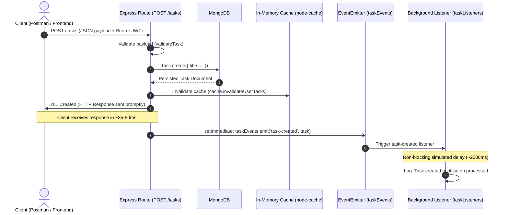

# Practical 10 — Asynchronous Processing with Event-Driven Architecture

## Objective

The objective of Practical 10 is to implement an asynchronous, event-driven background processing pattern in the Node.js/Express backend using Node.js's built-in `EventEmitter`. When a task is created or deleted, the backend persists the change to MongoDB, invalidates affected cache entries, and immediately sends the HTTP response back to the client. Secondary concerns, such as notification delivery, are handled asynchronously in the background on the event loop without blocking or delaying API client response times.

---

## 1. What is Node.js `EventEmitter`?

Node.js is built around an event-driven architecture where certain objects (called "emitters") periodically emit named events that cause `Function` objects ("listeners") to be called.

### 1.1 In-Process Publish-Subscribe
- The `EventEmitter` class belongs to Node.js's built-in `events` module (`require('events')`), requiring zero external dependencies.
- It provides a lightweight publish-subscribe mechanism within the running Node.js process:
  - Publishers trigger an event via `emitter.emit(eventName, ...args)`.
  - Subscribers register functions to react via `emitter.on(eventName, listener)`.

### 1.2 Synchronous Dispatch vs. Asynchronous Work
- By default, `emitter.emit()` iterates through all registered listener callbacks synchronously in the order they were registered.
- To prevent a long-running or delayed background job from blocking the caller, either:
  1. The event is emitted on the next turn of the event loop using `setImmediate(() => emitter.emit(...))`, or
  2. The listener function itself is asynchronous (`async (task) => { ... }`) and performs non-blocking operations (`setTimeout`, asynchronous I/O, database queries).

---

## 2. Request and Event Flow



### Why Separate Secondary Concerns from the Main Request?
1. **Low Latency & High Throughput**: The HTTP client only waits for critical path operations (request validation, database persistence, and cache invalidation). It does not wait for email notifications, audit webhooks, or third-party integrations.
2. **Failure Isolation**: If an external notification service times out or throws an error, the task has already been saved and the client has already received `201 Created`. A secondary notification failure must never fail an already-successful write operation.
3. **Decoupled Architecture**: Routes focus strictly on HTTP request/response orchestration; event listeners focus on domain reactions. Additional listeners (e.g. metrics, audit trails, analytics) can be registered without modifying the route handler.

---

## 3. Files Created and Modified

| File | Type | Purpose |
|---|---|---|
| `backend/events/taskEvents.js` | Created | Instantiates and exports the shared singleton `EventEmitter` with error listener support. |
| `backend/events/taskListeners.js` | Created | Registers background listeners for `task-created`, `task-deleted`, and safe error handling. Simulates 2s non-blocking delay. |
| `backend/routes/tasks.js` | Modified | Updated `POST /tasks` and `DELETE /tasks/:id` to emit domain events via `setImmediate()` after sending HTTP responses. |
| `backend/server.js` | Modified | Invokes `registerTaskListeners()` once on startup before incoming HTTP traffic is accepted. |
| `backend/test/events.test.js` | Created | Automated test suite verifying timing differences, MongoDB persistence, JWT protection, cache invalidation, and error resilience. |

---

## 4. How to Configure and Run

### 4.1 Prerequisites & Environment
Ensure `backend/.env` has:
```env
MONGO_URI=your_mongodb_connection_string
PORT=5000
JWT_SECRET=your_jwt_secret_key
CACHE_ENABLED=true
NOTIFICATION_DELAY_MS=2000
```

### 4.2 Start the Backend Server
```bash
cd backend
npm run dev
# Or for standard mode:
npm start
```
Console output upon startup:
```text
[Events] Task event listeners registered successfully
MongoDB connected
Task API running at http://localhost:5000
```

### 4.3 Run Automated Tests
```bash
cd backend
npm test
```

---

## 5. API Testing with Postman or Thunder Client

### 5.1 Authenticate & Obtain JWT
**POST** `http://localhost:5000/api/auth/login`
```json
{
  "email": "user@example.com",
  "password": "yourpassword"
}
```
Copy the returned `token`.

### 5.2 Create a Task (`POST /tasks`)
- **Method**: `POST`
- **URL**: `http://localhost:5000/tasks`
- **Headers**:
  - `Content-Type: application/json`
  - `Authorization: Bearer <your_jwt_token>`
- **Body (raw JSON)**:
```json
{
  "title": "Complete AWDF Practical 10",
  "description": "Implement EventEmitter background notifications",
  "priority": "high"
}
```
- **Response**: `201 Created` within ~40ms.

### 5.3 Delete a Task (`DELETE /tasks/:id`)
- **Method**: `DELETE`
- **URL**: `http://localhost:5000/tasks/<taskId>`
- **Headers**:
  - `Authorization: Bearer <your_jwt_token>`
- **Response**: `200 OK` (`"Task deleted successfully"`).

---

## 6. Actual Console Timing Evidence

The following console logs from our test execution demonstrate the timing difference between API response delivery and background notification completion:

```text
POST /tasks - 2026-10-21T15:23:07.618Z
[API] Task saved at: 2026-10-21T15:23:07.655Z
[CACHE INVALIDATE] Action: create | Key: tasks:user:6ad8d8db3b41e268a0860a19 | Total invalidations: 2
[API] Response sent at: 2026-10-21T15:23:07.656Z
[Notification] Handler started at: 2026-10-21T15:23:07.656Z
[Notification] Task "Timing Measurement Task" created for user 6ad8d8db3b41e268a0860a19 at: 2026-10-21T15:23:09.665Z
```

### Timing Breakdown
- **Task Saved in DB**: `15:23:07.655Z`
- **HTTP Response Sent to Client**: `15:23:07.656Z` (Total API response latency: **38 ms**)
- **Notification Handler Started**: `15:23:07.656Z`
- **Notification Handler Finished**: `15:23:09.665Z` (Took **2,009 ms**)
- **Conclusion**: The client received the HTTP 201 response **2.008 seconds before** the background notification handler finished.

---

## 7. Supplementary Feature: `task-deleted` Event

When a task is deleted (`DELETE /tasks/:id`), the endpoint executes:
1. Validates MongoDB `ObjectId`.
2. Verifies task exists and checks user ownership (`existing.user === req.user.id`).
3. Deletes the task from MongoDB.
4. Invalidates the user's cached tasks.
5. Sends HTTP `200 OK` response.
6. Emits `task-deleted` event via `setImmediate()`.

Console Evidence:
```text
DELETE /tasks/6ad8d8dd3b41e268a0860a22 - 2026-10-21T15:23:09.751Z
[CACHE INVALIDATE] Action: delete | Key: tasks:user:6ad8d8db3b41e268a0860a19 | Total invalidations: 3
[API] Delete response sent at: 2026-10-21T15:23:09.821Z
[Notification] Deletion handler started at: 2026-10-21T15:23:09.822Z
[Notification] Task "Task To Delete Event" (ID: 6ad8d8dd3b41e268a0860a22) deleted for user 6ad8d8db3b41e268a0860a19 at: 2026-10-21T15:23:10.837Z
```

If deletion fails (e.g. 404 Not Found or 403 Forbidden), no event is emitted.

---

## 8. Safe Error Handling & Resilience

### 8.1 Preventing Node.js Process Crashes
In Node.js, emitting an `'error'` event on an `EventEmitter` without an active listener throws an unhandled exception that **terminates the entire process**.
To prevent this, `backend/events/taskListeners.js` explicitly registers:
```javascript
taskEvents.on('error', (err) => {
  console.error(`[Event Error] Safe error handler caught: ${err.message || err}`);
});
```

### 8.2 Isolated Listener `try/catch`
Each asynchronous listener wraps its processing inside a `try/catch` block. If a third-party notification fails or if malformed task data is passed:
1. The error is safely caught and logged.
2. The Node.js process continues running normally.
3. Because the HTTP response has already been sent to the client, no duplicate response headers (`ERR_HTTP_HEADERS_SENT`) are attempted.

---

## 9. Important Limitations: EventEmitter vs. Distributed Message Queues

> [!IMPORTANT]
> **In-Memory & Process-Local**:
> Node.js `EventEmitter` runs entirely within the heap memory of a single Node.js process. It is **not** a persistent or distributed job queue.

| Feature | Node.js `EventEmitter` (Practical 10) | Production Queue (RabbitMQ / Redis BullMQ / AWS SQS) |
|---|---|---|
| **Storage Medium** | In-process RAM | Persistent disk / distributed broker |
| **Server Crash Resilience** | **Events in flight are lost** if process restarts | Jobs persist in queue and retry automatically |
| **Multi-Server Scaling** | Listeners only execute on the single server instance that handled the HTTP request | Any worker in a cluster can consume and process jobs |
| **Retry & Backoff** | Manual implementation required | Built-in exponential backoff, dead-letter queues |
| **Best Used For** | Lightweight in-app notifications, internal state decoupling | Critical emails, payment processing, video transcoding |

---

## 10. Test Execution Results

All 19 tests across Practical 8 and Practical 10 passed cleanly:

```text
▶ Practical 8: Server-Side Caching with node-cache (11 tests)
  ✔ 1. First GET /tasks request is a cache miss
  ✔ 2. A repeated GET /tasks request is a cache hit
  ✔ 3. The cached response matches the database response
  ✔ 4. Creating a task invalidates the cached list
  ✔ 5. Updating a task invalidates the cached list
  ✔ 6. Deleting a task invalidates the cached list
  ✔ 7. Requests by different authenticated users cannot receive each other's cached data
  ✔ 8. Invalid or missing JWT tokens are still rejected by protected routes
  ✔ 9. MongoDB or request errors are handled correctly
  ✔ 10. Disabling caching bypasses the cache and still returns valid task data
  ✔ 11. Observability: GET /api/cache/stats returns safe metrics

▶ Practical 10: Asynchronous Processing with Event-Driven Architecture (8 tests)
  ✔ 1. POST /tasks returns 201 Created and saves task to MongoDB
  ✔ 2. API response is sent immediately before the delayed notification completes
  ✔ 3. DELETE /tasks/:id emits task-deleted only after successful deletion
  ✔ 4. Failed DELETE (404 Not Found) does NOT emit task-deleted event
  ✔ 5. Invalid POST request (missing title) does NOT emit task-created event
  ✔ 6. Protected task routes reject missing or invalid JWTs without emitting events
  ✔ 7. Cache invalidation continues to work seamlessly on task creation and deletion
  ✔ 8. Safe error handling: emitting error event or faulty payload does not crash server

ℹ tests 19
ℹ suites 2
ℹ pass 19
ℹ fail 0
```
