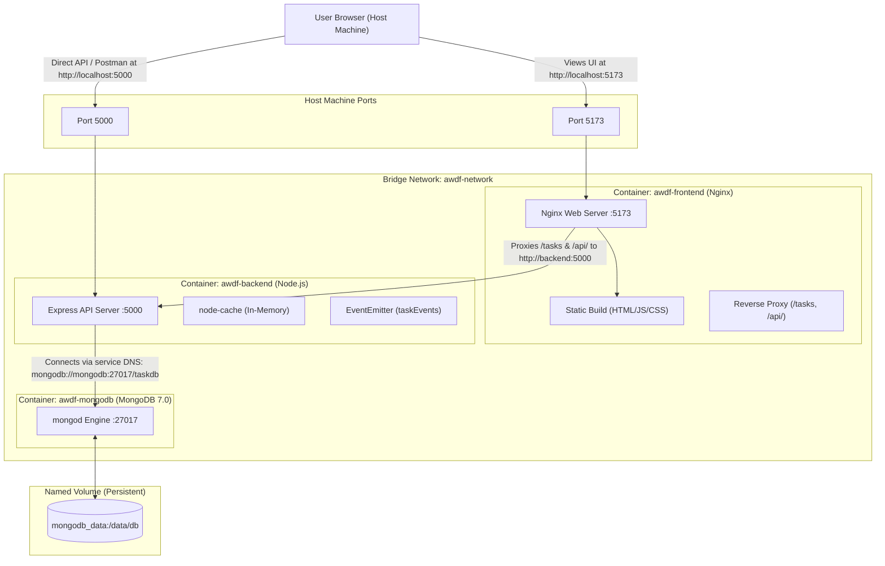

# Practical 11 — Containerization with Docker and Docker Compose

## Objective

The objective of Practical 11 is to containerize the complete full-stack web application:
1. **Frontend**: React (Vite SPA) compiled into optimized static assets and served using production-grade **Nginx**.
2. **Backend**: Node.js / Express REST API with JWT authentication, in-memory caching, and asynchronous `EventEmitter` notifications.
3. **Database**: Containerized **MongoDB 7.0** with persistent storage volumes and automated container health checking.
4. **Orchestration**: Orchestrated into a unified, isolated network using **Docker Compose** so the entire system launches reliably with a single command (`docker compose up --build`).

---

## 1. Container Architecture Overview



---

## 2. Service Descriptions and Roles

| Service | Base Image | Container Name | Host Port | Internal Port | Role |
|---|---|---|---|---|---|
| `frontend` | Multi-stage: `node:20-alpine` → `nginx:alpine` | `awdf-frontend` | `5173` | `5173` | Builds React production bundle with Vite; serves static assets; proxies API calls to `backend:5000`; handles SPA client-side routing fallback (`try_files $uri $uri/ /index.html;`). |
| `backend` | `node:20-alpine` | `awdf-backend` | `5000` | `5000` | Executes Express REST API; handles JWT authentication, CRUD operations, cache invalidation, and asynchronous `task-created` / `task-deleted` events. |
| `mongodb` | `mongo:7.0` | `awdf-mongodb` | Not published by default | `27017` | Persistent document database. Attached to named volume `mongodb_data` to ensure data persists across container restarts. |

---

## 3. Key Networking Concepts

### 3.1 Why the Backend Uses `mongodb:27017` instead of `localhost:27017`
In Docker, each container operates in its own isolated network namespace with its own `localhost` loopback interface (`127.0.0.1`):
- If the backend container attempts to connect to `mongodb://localhost:27017`, it looks for a MongoDB process running **inside the backend container itself**, where MongoDB does not exist.
- Docker Compose automatically provides an **embedded DNS server** on user-defined bridge networks (`awdf-network`). It resolves container service names (`mongodb`, `backend`, `frontend`) to their respective dynamic container IP addresses.
- Therefore, the backend must use:
  ```text
  mongodb://mongodb:27017/taskdb
  ```

### 3.2 Browser Context vs. Container Network
- Frontend JavaScript code executes **inside the user's browser on the host machine**, not inside the Docker network.
- The browser cannot resolve internal Docker DNS names like `http://backend:5000`.
- **Solution implemented**:
  1. Nginx serves the frontend on port `5173`.
  2. Nginx configuration (`frontend/nginx.conf`) defines reverse proxy rules:
     ```nginx
     location /tasks {
         proxy_pass http://backend:5000;
     }
     location /api/ {
         proxy_pass http://backend:5000;
     }
     ```
  3. Browser calls relative endpoints like `/tasks`. The browser contacts `http://localhost:5173/tasks`, and Nginx proxies the request internally across Docker's bridge network to `backend:5000`. This completely avoids CORS friction and prevents hardcoding container hostnames.

### 3.3 `EXPOSE` in Dockerfile vs. `ports` in `docker-compose.yml`
- **`EXPOSE <port>` in Dockerfile**:
  - Documentation metadata. Tells image consumers which port the application listens on.
  - **Does NOT** publish or bind the port to the host machine.
- **`ports: ["5000:5000"]` in `docker-compose.yml`**:
  - Sets up network address translation (NAT) and port forwarding between the host machine interface and the container.
  - Allows host applications (Postman, web browsers, curl) to reach the service from outside Docker.

---

## 4. Persistent Storage: Named Volumes

### How `mongodb_data` Preserves Data
Containers are ephemeral by default; when a container is destroyed, its writable layer is discarded.
- In `docker-compose.yml`:
  ```yaml
  volumes:
    - mongodb_data:/data/db

  volumes:
    mongodb_data:
      driver: local
  ```
- Docker mounts a managed storage directory on the host machine into the container's `/data/db` directory.
- Stopping or rebuilding containers (`docker compose down`) keeps `mongodb_data` intact.
- When new containers launch, they re-attach to `mongodb_data`, preserving all registered users, tasks, and indexes.

> [!CAUTION]
> Running `docker compose down -v` deletes all named volumes and permanently wipes database data. Always omit the `-v` flag unless a fresh reset is explicitly intended.

---

## 5. Security & Environment Configuration

### 5.1 Excluding Sensitive Files with `.dockerignore`
Both `backend/.dockerignore` and `frontend/.dockerignore` prevent leaking credentials and heavy local dependencies into Docker build contexts:
- `node_modules` (ensures clean, deterministic dependencies compiled for Alpine Linux)
- `.env` and `.env.*` (prevents baking JWT secrets and database credentials into image layers)
- `.git` and `test` directories (reduces image transfer size)

### 5.2 Connecting to MongoDB Atlas vs. Local Container
By default, `docker-compose.yml` falls back to the containerized database:
```yaml
MONGO_URI: ${MONGO_URI:-mongodb://mongodb:27017/taskdb}
```
To connect the containerized backend to your cloud **MongoDB Atlas** cluster instead:
1. Create a `.env` file in the repository root (using [.env.example](file:///.env.example)):
   ```env
   MONGO_URI=mongodb+srv://<username>:<password>@<cluster>.mongodb.net/taskdb?retryWrites=true&w=majority
   JWT_SECRET=your_production_secret
   ```
2. Start Docker Compose:
   ```bash
   docker compose up --build
   ```
   Docker Compose automatically substitutes `MONGO_URI` into the backend environment without committing secrets.

---

## 6. How to Build, Run, and Inspect

### 6.1 Start the Complete Stack
```bash
docker compose up --build
```
Or run in the background (detached mode):
```bash
docker compose up --build -d
```

### 6.2 Inspect Container Status
```bash
docker compose ps
```
Expected output:
```text
NAME            IMAGE               COMMAND                  SERVICE    STATUS              PORTS
awdf-mongodb    mongo:7.0           "docker-entrypoint.s…"   mongodb    Up (healthy)        27017/tcp
awdf-backend    portfolio-backend   "docker-entrypoint.s…"   backend    Up (healthy)        0.0.0.0:5000->5000/tcp
awdf-frontend   portfolio-frontend  "nginx -g 'daemon of…"   frontend   Up                  0.0.0.0:5173->5173/tcp
```

### 6.3 View Container Logs
```bash
# Follow all container logs:
docker compose logs -f

# View backend logs only:
docker compose logs -f backend

# View last 100 lines:
docker compose logs --tail=100
```

### 6.4 Stop the Application Safely
```bash
docker compose down
```
*(Data in `mongodb_data` is safely preserved).*

---

## 7. Troubleshooting Guide

### Issue 1: Host Port Conflict (`Bind for 0.0.0.0:5000 failed`)
- **Cause**: A local Node.js server or another application is already listening on port 5000 or 5173.
- **Solution**:
  - Stop the host process:
    ```powershell
    # Windows PowerShell: Find process using port 5000
    Get-NetTCPConnection -LocalPort 5000 | Select-Object OwningProcess
    Stop-Process -Id <ProcessId>
    ```
  - Or remap host ports in `docker-compose.yml` (e.g. `"5001:5000"`).

### Issue 2: Backend Cannot Connect to MongoDB
- **Cause**: Backend attempted to connect before MongoDB finished initializing, or used `localhost`.
- **Solution**:
  - Ensure `docker-compose.yml` has the `depends_on` condition set to `service_healthy`.
  - Verify that `MONGO_URI` is set to `mongodb://mongodb:27017/taskdb`.

### Issue 3: Direct SPA Route Navigation Returns 404 (e.g., refreshing `/tasks`)
- **Cause**: Standard web servers look for a physical file at `/tasks/index.html`.
- **Solution**:
  - Handled in `frontend/nginx.conf` via `try_files $uri $uri/ /index.html;`, ensuring client-side React Router handles the route.

### Issue 4: Stale Docker Build Cache
- **Cause**: Docker reused cached intermediate layers after changes to code.
- **Solution**:
  ```bash
  docker compose build --no-cache
  docker compose up -d
  ```

---

## 8. Environment Verification Status

- **Static Configuration Validation**: Complete. `backend/Dockerfile`, `frontend/Dockerfile`, `frontend/nginx.conf`, `docker-compose.yml`, `.dockerignore`, and `.env.example` are configured and validated.
- **Frontend Build & Linter**: Passed with 0 errors (`npm run build`, `npm run lint`).
- **Backend Test Suite**: Passed with 19/19 tests passing (`npm test`).
- **Host Docker Engine**: `docker` CLI is not installed in the current Windows environment. Once Docker Desktop is installed, run `docker compose up --build` to execute runtime container verification.
