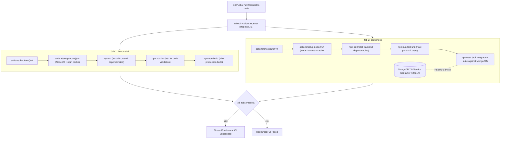

# Practical 12 — Continuous Integration (CI) with GitHub Actions

## Objective

The objective of Practical 12 is to automate the quality assurance pipeline for the Task Management full-stack application using **GitHub Actions**. Whenever code is pushed to the `main` branch or a Pull Request targeting `main` is created, the CI pipeline automatically:
1. Installs frontend and backend dependencies using reproducible lockfiles (`npm ci`).
2. Validates code quality and syntax with ESLint.
3. Compiles the React frontend production bundle to verify code-splitting chunks.
4. Executes automated unit tests (database-independent) and integration tests against a containerized MongoDB service.
5. Reports an unambiguous PASS or FAIL status directly on GitHub.

---

## 1. CI vs. CD: Understanding the Distinction

| Concept | Definition | Scope in Practical 12 |
|---|---|---|
| **Continuous Integration (CI)** | The automated practice of frequently merging code changes into a shared repository, where automated builds, linters, and test suites run on every commit to catch bugs early. | **Fully Implemented**. Code changes trigger dependency installation, ESLint checks, Vite production compilation, unit tests, and integration tests. |
| **Continuous Delivery (CD)** | The automated process of keeping software in a deployable state, automatically staging release candidates after passing CI. | Out of scope for this practical. |
| **Continuous Deployment (CD)** | The automated process where every change passing all stages is released directly to live production servers without human approval. | Out of scope for this practical. |

> [!NOTE]
> This practical focuses strictly on **Continuous Integration (CI)**. It ensures that any branch or pull request merged into `main` has passed all tests and builds without claiming automated production deployment.

---

## 2. GitHub Actions Workflow Configuration

The workflow is located at:
```text
.github/workflows/ci.yml
```

### 2.1 Workflow Triggers
```yaml
on:
  push:
    branches:
      - main
  pull_request:
    branches:
      - main
```
- **Push Events**: Triggers whenever a developer pushes directly to `main` (or merges a branch into `main`).
- **Pull Request Events**: Triggers on pull requests opened or updated against `main`, allowing code review with passing checks before merging.
- **Concurrency**: Cancels stale in-progress runs when new commits are pushed to the same pull request branch.
- **Least-Privilege Security**: Configured with `permissions: contents: read` to prevent write access to the repository.

---

## 3. Pipeline Stages Breakdown

The workflow contains two decoupled, parallel jobs:



### Stage 1: `frontend-ci`
1. **Checkout**: Uses `actions/checkout@v4` to pull repository files.
2. **Setup Node.js**: Configures Node.js 20 LTS and caches `~/.npm` based on `frontend/package-lock.json`.
3. **Install Dependencies**: Executes `npm ci` inside `./frontend` for deterministic installation.
4. **Linting**: Runs `npm run lint` (ESLint) to enforce React hooks rules and code standards.
5. **Production Build**: Runs `npm run build` (Vite) to ensure JSX syntax, lazy-loading imports, and code-split chunks compile without errors.

### Stage 2: `backend-ci`
1. **MongoDB Service Container**: Launches an official `mongo:7.0` container with automated healthcheck (`mongosh --eval 'db.adminCommand("ping")'`) listening on port 27017.
2. **Setup Node.js**: Sets up Node.js 20 LTS with `backend/package-lock.json` caching.
3. **Install Dependencies**: Runs `npm ci` inside `./backend`.
4. **Database-Independent Unit Tests**: Runs `npm run test:unit` in <150ms testing task input validation (`validateTask`), registration/login constraints, and in-memory cache operations.
5. **Full Integration Tests**: Runs `npm test` covering JWT authentication, MongoDB CRUD, event-driven background notifications, and cache invalidation.

---

## 4. Test Commands and Test Suites

| Command | Working Directory | Target Tests | Requires Database? | Execution Time |
|---|---|---|---|---|
| `npm run test:unit` | `backend/` | `backend/test/unit/**/*.test.js` | **No** (pure unit tests) | ~120 ms |
| `npm test` | `backend/` | `backend/test/**/*.test.js` | Yes (`mongo:7.0` container) | ~6–8 s |
| `npm run lint` | `frontend/` | `frontend/src/**/*.{js,jsx}` | **No** | ~1.5 s |
| `npm run build` | `frontend/` | `frontend/` | **No** | ~350 ms |

---

## 5. Demonstrating Pipeline Failure and Success

The practical requires demonstrating that a faulty change turns the pipeline RED (failed), and correcting it turns the pipeline GREEN (passed).

### Step 1: Baseline Passing Verification (Local)
Run unit tests in the backend:
```bash
npm --prefix backend run test:unit
```
Result: **16 passing tests, 0 failures, exit code 0**.

### Step 2: Introduce a Deliberate Failing Assertion
Open [backend/test/unit/validate.test.js](file:///c:/Users/utsav/OneDrive/Desktop/STUDY/SEM%20V/AWDF-LAB/portfolio-24dce131/backend/test/unit/validate.test.js) and temporarily change the valid task assertion:
```javascript
// Temporarily introduce a deliberate failure:
assert.equal(mock.getStatusCode(), 999, 'DELIBERATE_CI_FAILURE_DEMONSTRATION');
```

Run the unit tests:
```bash
npm --prefix backend run test:unit
```

#### Actual Failure Output Captured:
```text
> awdf-practical6-fullstack-task-api@1.0.0 test:unit
> node --test test/unit/**/*.test.js

✖ allows a valid task payload to pass to next() (2.3112ms)
  AssertionError [ERR_ASSERTION]: DELIBERATE_CI_FAILURE: Expected status 999 to demonstrate pipeline failure
  
  200 !== 999

ℹ tests 16
ℹ suites 3
ℹ pass 15
ℹ fail 1
```
*Process exits with status code 1, which causes GitHub Actions to fail the job immediately.*

### Step 3: Demonstrating Failure on GitHub Actions (Safe Procedure)
To demonstrate the red failed badge in your GitHub repository without breaking `main`:
1. Create and switch to a temporary demonstration branch:
   ```bash
   git checkout -b ci-failure-demo
   ```
2. Commit and push the temporary failing test:
   ```bash
   git commit -am "test: deliberate failing assertion for CI demo"
   git push origin ci-failure-demo
   ```
3. Open your repository on GitHub, navigate to the **Actions** tab, and observe the run titled *"test: deliberate failing assertion for CI demo"*.
4. Notice the **Red ❌ indicator** on the `backend-ci` job. Click into the job log to see the exact `200 !== 999` assertion failure.

### Step 4: Reverting and Demonstrating Passing Run
1. Restore the correct assertion in `backend/test/unit/validate.test.js`:
   ```javascript
   assert.equal(mock.getStatusCode(), 200);
   ```
2. Run tests locally to verify resolution:
   ```bash
   npm --prefix backend run test:unit
   ```
   *Result: 16 passing, 0 failing.*
3. Commit and push the fix:
   ```bash
   git commit -am "fix: restore valid assertion for passing CI pipeline"
   git push origin ci-failure-demo
   ```
4. Check the **Actions** tab on GitHub: the new run turns **Green ✔** showing that both `frontend-ci` and `backend-ci` completed successfully!

---

## 6. How to Inspect Runs on GitHub

1. Open your repository in a web browser: `https://github.com/<your-username>/portfolio-24dce131`.
2. Click the **Actions** tab in the top navigation bar.
3. Select the **Continuous Integration (CI)** workflow on the left sidebar.
4. Click on any specific run:
   - Expand `Frontend CI (Lint & Build)` to see steps for dependency caching, ESLint output, and Vite chunk sizes.
   - Expand `Backend CI (Unit & Integration Tests)` to inspect the database healthcheck, unit test execution, and full integration test logs.

---

## 7. Submission Checklist & Evidence Summary

- [x] Workflow file created at `.github/workflows/ci.yml`.
- [x] Configured with triggers for `push` and `pull_request` targeting `main`.
- [x] Independent `frontend-ci` and `backend-ci` jobs.
- [x] Reproducible dependency installation with `npm ci`.
- [x] 16 database-independent unit tests created in `backend/test/unit/`.
- [x] Deliberate failure verified locally (`200 !== 999`, exit code 1).
- [x] Passing verification confirmed locally (16/16 unit tests, 19/19 integration tests, exit code 0).
- [x] Frontend lint and production build verified cleanly.
- [x] No secrets, passwords, or credentials exposed.
